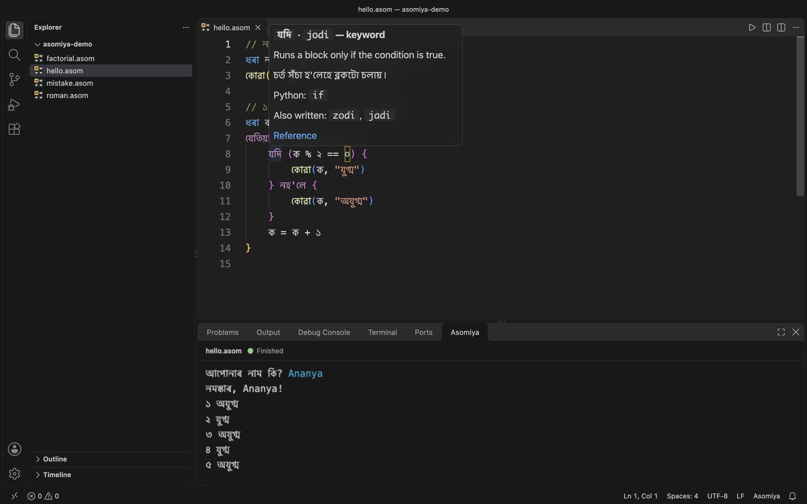

# অসমীয়া — অসমীয়া ভাষাত লিখা এটা প্ৰগ্ৰামিং ভাষা

> Read in English → [README.md](README.md)
>
> **ব্ৰাউজাৰতে চলাই চাওক → [https://asomiya.codes](https://asomiya.codes)**। একো ইনষ্টল কৰিব নালাগে।

## এইটো কি?

**অসমীয়া** এটা সৰু, শিক্ষামূলক প্ৰগ্ৰামিং ভাষা। ইয়াৰ মূল শব্দ, চলকৰ নাম, সংখ্যা আৰু ভুলৰ বাৰ্তা
সকলো অসমীয়াত। প্ৰগ্ৰামবোৰ চলায় TypeScriptত লিখা এটা সঁচা ইন্টাৰপ্ৰেটাৰে। ই প্ৰথমে লিখনিটো
শব্দত ভাঙে (lexer), তাৰপিছত বাক্যৰ গঠন বুজে (parser), আৰু শেষত প্ৰতিটো বাক্য নিজে চলায়
(interpreter)। ই অসমীয়া লিখনিক ইংৰাজী বা JavaScriptলৈ অনুবাদ নকৰে।

```
ধৰা ভাষা = "অসমীয়া"
ধৰা বয়স = ২০

কোৱা("নমস্কাৰ, পৃথিৱী!")
কোৱা("এই প্ৰগ্ৰামটোৰ ভাষা: " + ভাষা)

যদি (বয়স >= ১৮) {
    কোৱা("প্ৰাপ্তবয়স্ক")
} নহ'লে {
    কোৱা("অপ্ৰাপ্তবয়স্ক")
}
```

ফলাফল:

```
নমস্কাৰ, পৃথিৱী!
এই প্ৰগ্ৰামটোৰ ভাষা: অসমীয়া
প্ৰাপ্তবয়স্ক
```

## কিয় অসমীয়াত?

প্ৰায় সকলো প্ৰগ্ৰামিং ভাষাৰ মূল শব্দ ইংৰাজী। কিন্তু প্ৰগ্ৰাম বুজা আৰু চলোৱাৰ কামটোত ইংৰাজীৰ কোনো
বিশেষ ভূমিকা নাই। এই প্ৰকল্পই সেইটোকে দেখুৱায়। চলকৰ নাম `বয়স` হ'ব পাৰে, লুপ `যেতিয়ালৈকে` দি লিখিব
পাৰি, আৰু `১০ + ২০` লিখিলে `৩০` ছপা হয়। যিসকলে নিজৰ ভাষাত প্ৰগ্ৰামিং শিকিব বিচাৰে, আৰু যিসকলে এটা
প্ৰগ্ৰামিং ভাষা ভিতৰৰ পৰা কেনেকৈ কাম কৰে চাব বিচাৰে, এই প্ৰকল্প তেওঁলোকৰ বাবে।

এইটো এটা পৰীক্ষামূলক "খেলনা" ভাষা। ইয়াৰ লক্ষ্য শুদ্ধতা আৰু সৰলতা, গতি নহয়।

## ইনষ্টল কৰা

Node.js ২০ বা তাতকৈ নতুন সংস্কৰণ লাগিব।

```sh
npm install -g asomiya
```

বা এই ৰিপজিটৰীৰ পৰা:

```sh
npm install
npm run build
npm link        # তাৰ পিছত `asomiya` কমাণ্ড ব্যৱহাৰ কৰিব পাৰিব
```

## আৰম্ভণি

```sh
asomiya run examples/hello.asom    # এটা ফাইল চলাওক
asomiya                            # ইণ্টাৰেক্টিভ REPL খোলক
```

প্ৰগ্ৰাম ফাইলৰ এক্সটেনচন হ'ল **`.asom`**। `.as` আগৰে পৰা ActionScript আৰু AngelScriptৰ বাবে ব্যৱহৃত,
আৰু `.asm` এচেম্বলি ভাষাৰ। সেয়েহে বেলেগ এক্সটেনচন লোৱা হৈছে।

## মূল শব্দ

| শব্দ           | অৰ্থ / কাম                                 |
| ------------- | ----------------------------------------- |
| `ধৰা`         | নতুন চলক ঘোষণা (যেনে অংকত "ধৰা হওক x = ৫") |
| `কোৱা`        | স্ক্ৰীণত ছপা কৰা                            |
| `যদি`         | চৰ্ত                                       |
| `নহ'লে`       | চৰ্ত মিছা হ'লে (`নহলে` বুলিও লিখিব পাৰি)    |
| `যেতিয়ালৈকে`  | চৰ্ত সঁচা হৈ থকালৈকে বাৰে বাৰে চলোৱা (লুপ)   |
| `ৰখা`         | লুপ ৰখোৱা                                  |
| `আগবাঢ়া`      | লুপৰ পৰৱৰ্তী পাকলৈ যোৱা                     |
| `ফাংচন`       | ফাংচন ঘোষণা                               |
| `ঘূৰাইদিয়া`    | ফাংচনৰ পৰা মান ঘূৰাই দিয়া                  |
| `সঁচা`, `মিছা` | সত্য-মিথ্যা মান                             |
| `খালী`        | কোনো মান নাই                              |
| `আৰু`, `বা`    | যুক্তিৰ "আৰু" আৰু "বা" (`&&`, `\|\|`ও চলে)    |
| `নহয়`         | যুক্তিৰ "নহয়" (`!`ও চলে)                    |

প্ৰতিটো শব্দ কিয় বাছি লোৱা হৈছে, আৰু কোনবোৰ শব্দ এতিয়াও আলোচনাৰ অধীনত, সেয়া
[শব্দকোষ](docs/KEYWORDS.md)ত লিখা আছে।

## চলক

```
ধৰা চহৰ = "গুৱাহাটী"     // ঘোষণা
চহৰ = "যোৰহাট"            // নতুন মান দিয়া
ধৰা নদী                    // মান নিদিলে খালী
```

- একেটা পৰিসৰত (scope) একেটা নাম দুবাৰ `ধৰা` দি ঘোষণা কৰিব নোৱাৰি।
- ঘোষণা নকৰাকৈ কোনো নাম ব্যৱহাৰ কৰিলে ভুল দেখুৱাব।
- প্ৰতিটো `{ … }` ব্লকে নিজৰ পৰিসৰ সৃষ্টি কৰে।

## মানৰ প্ৰকাৰ

| প্ৰকাৰ      | উদাহৰণ             | টোকা                                         |
| ---------- | ------------------ | -------------------------------------------- |
| `সংখ্যা`    | `২৪`, `24`, `৩.১৪` | অসমীয়া বা ইংৰাজী অংক, কিন্তু একেলগে মিহলাই নহয় |
| `পাঠ`      | `"নমস্কাৰ"`         | কেৱল দুটা উদ্ধৃতি চিহ্ন (`"`) দি                 |
| `সঁচা-মিছা` | `সঁচা`, `মিছা`      |                                              |
| `খালী`     | `খালী`             |                                              |
| `তালিকা`   | `[১, "দুই", সঁচা]`   | `ল[০]` দি প্ৰথম উপাদান পোৱা যায়               |
| `ফাংচন`    | `ফাংচন …`          | ফাংচনক চলকত ৰাখিব আৰু আন ফাংচনলৈ পঠিয়াব পাৰি  |

সংখ্যা সাধাৰণতে অসমীয়া অংকত ছপা হয়। `--ascii-digits` দিলে 0-9ত ছপা হয়।

পাঠৰ দৈৰ্ঘ্য আৰু সূচীয়ে পূৰ্ণ আখৰ গণে। সেয়েহে `দৈৰ্ঘ্য("নাম")` হ'ল `২` (না, ম), আৰু
যুক্তাক্ষৰ (যেনে `ক্ষ`) ভাঙি নাযায়।

## অপাৰেটৰ

| অপাৰেটৰ         | কাম                                        |
| --------------- | ------------------------------------------ |
| `+ - * / %`     | যোগ, বিয়োগ, পূৰণ, হৰণ, ভাগশেষ               |
| `+` (পাঠৰ সৈতে) | জোৰা লগোৱা: `"বয়স " + ২৪` → `বয়স ২৪`       |
| `== !=`         | সমান / অসমান (প্ৰকাৰ বেলেগ হ'লে সদায় অসমান) |
| `< > <= >=`     | তুলনা (দুয়োটা সংখ্যা বা দুয়োটা পাঠ)            |
| `আৰু` `বা` `নহয়` | যুক্তি                                       |

গুণ আৰু হৰণ যোগ-বিয়োগৰ আগতে হয়: `২ + ৩ * ৪` হ'ল `১৪`। বন্ধনী দি ক্ৰম সলনি কৰিব পাৰি।
শূন্যৰে হৰণ কৰিলে ভুল দেখুৱাব।

## চৰ্ত

```
যদি (নম্বৰ >= ৯০) {
    কোৱা("ক")
} নহ'লে যদি (নম্বৰ >= ৬০) {
    কোৱা("খ")
} নহ'লে {
    কোৱা("গ")
}
```

চৰ্তটো `সঁচা` বা `মিছা` হ'বই লাগিব। `যদি (০)` বা `যদি ("ক")` লিখিলে ভুল দেখুৱাব, যাতে কোনো ভুল
চুপচাপে পাৰ হৈ নাযায়।

## লুপ

```
ধৰা ক = ১
যেতিয়ালৈকে (ক <= ৫) {
    কোৱা(ক)
    ক = ক + ১
}
```

`ৰখা` লিখিলে লুপৰ পৰা তৎক্ষণাৎ ওলাই আহে। কোনো লুপ কেতিয়াও শেষ নহ'লে ইন্টাৰপ্ৰেটাৰে এটা
নিৰ্দিষ্ট পদক্ষেপৰ সীমাৰ পিছত (সাধাৰণতে ১ কোটি) সেইটো ৰখাই দিয়ে আৰু ভুল দেখুৱায়।

## ফাংচন

```
ফাংচন যোগ(ক, খ) {
    ঘূৰাইদিয়া ক + খ
}

ধৰা ফলাফল = যোগ(১০, ২০)
কোৱা(ফলাফল)          // ৩০
```

- যিমানটা প্ৰাচল আছে, সিমানটা মানেই দিব লাগিব।
- `ঘূৰাইদিয়া` নিলিখিলে ফাংচনে `খালী` ঘূৰাই দিয়ে।
- ফাংচনে নিজকে মাতিব পাৰে (ৰিকাৰ্চন)। গভীৰতাৰ সীমা ৫০০।
- ফাংচনৰ ভিতৰত ঘোষণা কৰা চলক বাহিৰৰ পৰা দেখা নাযায়। ভিতৰৰ ফাংচনে বাহিৰৰ চলক মনত ৰাখে
  (closure)।

## অন্তৰ্নিৰ্মিত ফাংচন

| ফাংচন                 | কাম                                   |
| --------------------- | ------------------------------------- |
| `দৈৰ্ঘ্য(x)`            | পাঠ বা তালিকাৰ দৈৰ্ঘ্য                  |
| `প্ৰকাৰ(x)`            | মানৰ প্ৰকাৰৰ নাম, যেনে `"সংখ্যা"`       |
| `সংখ্যা(x)`            | পাঠক সংখ্যালৈ ৰূপান্তৰ (নোৱাৰিলে `খালী`) |
| `পাঠ(x)`              | যিকোনো মানক পাঠলৈ ৰূপান্তৰ              |
| `পূৰ্ণাংক(x)`           | দশমিকৰ পিছৰ অংশ বাদ দিয়া              |
| `সংযোজন(তালিকা, মান)` | তালিকাৰ শেষত নতুন মান যোগ কৰা          |
| `সোধা(প্ৰশ্ন)`          | ব্যৱহাৰকাৰীৰ পৰা এটা শাৰী পঢ়া          |

## ইংৰাজী আখৰত লিখা

অসমীয়া কীব'ৰ্ড নাই? প্ৰতিটো মূল শব্দ আৰু অন্তৰ্নিৰ্মিত ফাংচন ইংৰাজী আখৰতো লিখিব পাৰি, চেটত যিদৰে লিখোঁ
তেনেকৈ:

```
dhora naam = "Rita"
jodi (naam != "") { kowa("Nomoskar, " + naam) } nohole { kowa("naam nai") }
```

ইংৰাজী আখৰত অসমীয়া লিখাৰ কোনো এটা নিৰ্দিষ্ট বানান নাই, সেয়েহে প্ৰতিটো শব্দৰ কেইবাটাও প্ৰচলিত বানান
চলে (`kowa`, `kuwa`, `kua`; `xosa`, `hosa`, `sosa` …)। শব্দবোৰ সৰু আখৰত লিখিব লাগিব। ভুল বানান
লিখিলে (`kowaa`) ভুলৰ বাৰ্তাই শুদ্ধ শব্দটো (`kowa`) কৈ দিয়ে। ইংৰাজী আখৰত লিখা প্ৰগ্ৰামে সংখ্যা 0-9
আৰু `xosa`/`misa`/`khali` হিচাপে দেখুৱায়। সম্পূৰ্ণ তালিকা: [docs/ROMAN.md](docs/ROMAN.md)।

## অনলাইন প্লেগ্ৰাউণ্ড

[প্লেগ্ৰাউণ্ডত](https://asomiya.codes) প্ৰগ্ৰাম লিখি ব্ৰাউজাৰতে চলাব পাৰি। প্ৰগ্ৰামটো আপোনাৰ কম্পিউটাৰতে চলে, কোনো
চাৰ্ভাৰলৈ নাযায়। তাত উদাহৰণবোৰ আছে, `সোধা`ৰ বাবে এটা ইনপুট বাকচ আছে (প্ৰতিবাৰ মাতিলে এটা শাৰী পঢ়ে),
আৰু প্ৰগ্ৰামটো লিংক হিচাপে আনক পঠিয়াব পাৰি।

## VS Code এক্সটেনশ্যন

VS Code, Cursor, Windsurf আৰু VSCodium ৰ বাবে **অসমীয়া এক্সটেনশ্যন**: দুয়োটা লিপিত ক’ডৰ ৰং, লিখোঁতেই ভুল, হভাৰ সহায়, ▶ চলোৱা বুটাম (ফলাফল শুদ্ধ অসমীয়া আখৰত অসমীয়া পেনেলত ওলায়), আৰু **Python ত দেখুওৱা**। Extensions ত “Asomiya” বিচাৰক, বা [VS Code Marketplace](https://marketplace.visualstudio.com/items?itemName=asomiya.asomiya) / [Open VSX](https://open-vsx.org/extension/asomiya/asomiya) চাওক। বিতং: [asomiya.codes/as/extension](https://asomiya.codes/as/extension/)।



## অন্যান্য নিয়ম

- মন্তব্য: `// শাৰীৰ শেষলৈকে` আৰু `/* … */`।
- এটা শাৰীত কেইবাটাও বাক্য লিখিবলৈ `;` বা দাড়ি `।` ব্যৱহাৰ কৰক।
- দীঘল এক্সপ্ৰেছন অপাৰেটৰৰ পিছত পৰৱৰ্তী শাৰীলৈ নিব পাৰি। বন্ধনী `( )` আৰু `[ ]`ৰ ভিতৰত নতুন শাৰীৰ
  কোনো প্ৰভাৱ নাই।

## কমাণ্ড লাইন

```
asomiya run <ফাইল> [বিকল্প]     প্ৰগ্ৰাম চলোৱা
asomiya [বিকল্প]                REPL খোলা

  -l, --lang <as|en>   ভুলৰ বাৰ্তাৰ ভাষা (সাধাৰণতে অসমীয়া)
  --ascii-digits       0-9 অংকত ছপা কৰা
  --max-steps <n>      পদক্ষেপৰ সীমা (০ = সীমাহীন)
  --max-depth <n>      ফাংচন মতাৰ সৰ্বোচ্চ গভীৰতা
```

প্ৰগ্ৰাম সফল হ'লে প্ৰস্থান-কোড `0`, প্ৰগ্ৰামত ভুল থাকিলে `1`, আৰু ফাইল নাপালে বা কমাণ্ড ভুল হ'লে `2`।

REPLত সম্পূৰ্ণ বাক্য এটা লিখি Enter টিপিলেই সেইটো চলে। `{` খোলা থাকিলে পৰৱৰ্তী শাৰীৰ বাবে অপেক্ষা
কৰে। REPLতো `সোধা` চলে: ই আপুনি লিখা পৰৱৰ্তী শাৰীটো পঢ়ে।

- `.সহায়`: সহায়
- `.বাতিল`: আধৰুৱা বাক্য বাতিল কৰা
- `.প্ৰস্থান` বা Ctrl+D: ওলাই যোৱা
- Ctrl+C: চলি থকা প্ৰগ্ৰামকে ধৰি তৎক্ষণাৎ ওলাই যোৱা

REPLত কাঁড় চাবিৰে (arrow key) আগৰ শাৰী ঘূৰাই অনাৰ সুবিধা নাই। এনে সুবিধা দিয়া লাইন-এডিটৰবোৰে
অসমীয়া আখৰৰ বহল ভুলকৈ গণে আৰু স্ক্ৰীণখন খেলিমেলি কৰে, সেয়েহে টাইপ কৰা লিখনি টাৰ্মিনেলৰ হাততে
এৰি দিয়া হৈছে।

## ভুলৰ বাৰ্তা

প্ৰতিটো ভুলৰ এটা কোড থাকে, আৰু ভুলটো ক'ত হৈছে সেই শাৰীটো দেখুওৱা হয়:

```
চলোৱাৰ সময়ৰ ভুল [R001]: "খ" নামৰ কোনো চলক ঘোষণা কৰা হোৱা নাই (প্ৰথমে "ধৰা খ = …" লিখক)
  --> program.asom:2:10
  |
2 | কোৱা(ক + খ)
  |        ^
```

- `L…` — শব্দ-বিশ্লেষণৰ ভুল (যেনে বন্ধ নকৰা পাঠ)
- `P…` — বাক্য-গঠনৰ ভুল (যেনে বন্ধনী বন্ধ কৰা নাই)
- `R…` — চলোৱাৰ সময়ৰ ভুল (যেনে শূন্যৰে হৰণ)

সকলো ভুলৰ তালিকা: [docs/ERRORS.md](docs/ERRORS.md)।

## ভিতৰৰ গঠন

```
লিখনি → শব্দ বিশ্লেষক (lexer) → শব্দৰ শাৰী → বাক্য বিশ্লেষক (parser) → গছৰ গঠন (AST) → ইন্টাৰপ্ৰেটাৰ → ফলাফল
```

বিতংকৈ: [docs/ARCHITECTURE.md](docs/ARCHITECTURE.md)।

## উদাহৰণ

[`examples/`](examples) ফ'ল্ডাৰত চলক, চৰ্ত, লুপ, ফাংচন, তালিকা আৰু ইনপুটৰ উদাহৰণ আছে।

## অৱদান

ভাষাটোৰ শব্দ আৰু বাৰ্তা যিমান পাৰি স্বাভাৱিক অসমীয়া হোৱাটো দৰকাৰী। কোনো শব্দ খেলিমেলি বা অস্বাভাৱিক
যেন লাগিলে অনুগ্ৰহ কৰি জনাওক। বিশেষকৈ শব্দকোষত "provisional" বুলি চিহ্নিত শব্দবোৰৰ ক্ষেত্ৰত।
বিতং: [CONTRIBUTING.md](CONTRIBUTING.md)।

## নিৰ্মাতা আৰু সহযোগী

- **দেবাশীষ বৰদলৈ** ([@d43ash1sh](https://github.com/d43ash1sh), ORCID [0009-0006-0473-0774](https://orcid.org/0009-0006-0473-0774)) — নিৰ্মাতা
- **অৰ্ণৱ শৰ্মা** ([@arnabsmh](https://github.com/arnabsmh)) — অৱদানকাৰী
- **সিদ্ধাৰ্থ বৰা** ([@siddharthaborah](https://github.com/siddharthaborah)) — অৱদানকাৰী
- **Bigratom Saikia** ([@saikiabigratom-design](https://github.com/saikiabigratom-design)) — অৱদানকাৰী
- **Nitish** ([@Nitishsarma45678](https://github.com/Nitishsarma45678)) — অৱদানকাৰী

## অনুজ্ঞাপত্ৰ

[MIT](LICENSE)
