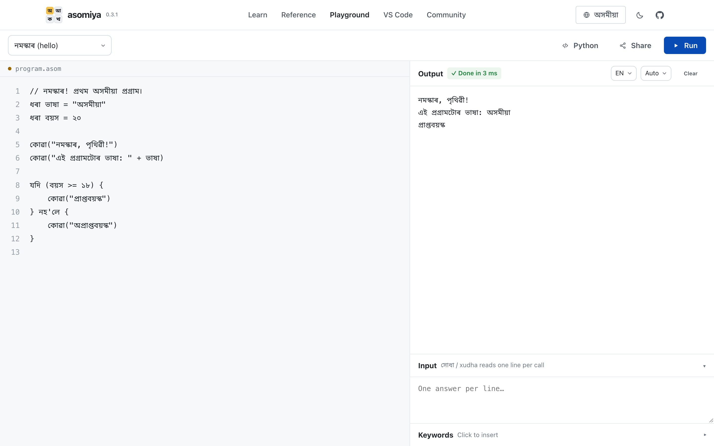
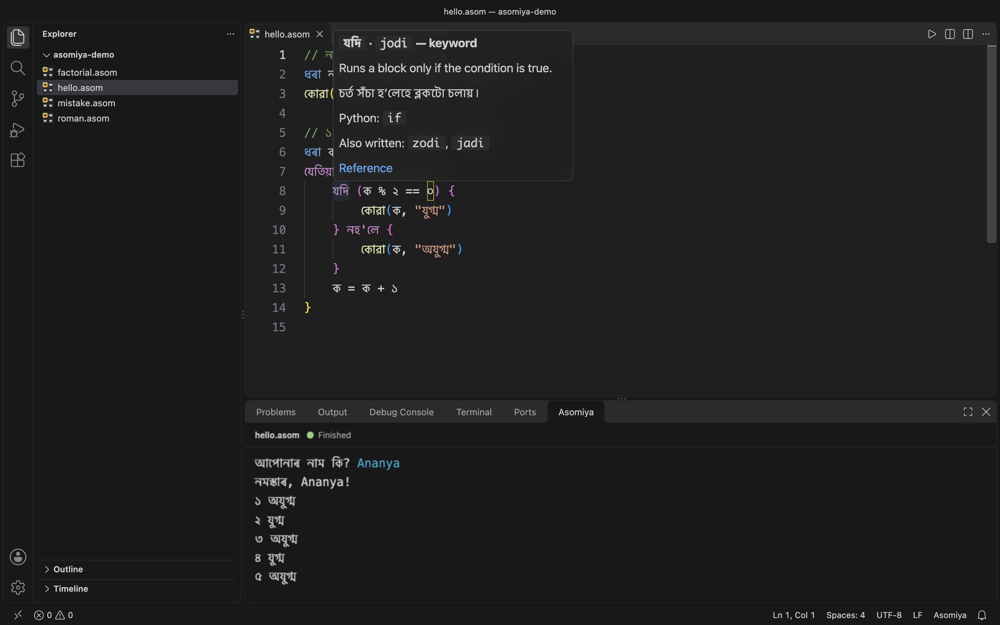

<div align="center">

# অসমীয়া · Asomiya

**A programming language in Assamese.**<br>
Write real programs in অসমীয়া script, or in English letters the way you type Assamese in chats.

[](https://www.npmjs.com/package/asomiya)
[](https://www.npmjs.com/package/asomiya)
[](https://github.com/d43ash1sh/asomiya/actions/workflows/ci.yml)
[](https://nodejs.org)
[](https://github.com/d43ash1sh/asomiya/blob/main/LICENSE)
[](https://open-vsx.org/extension/asomiya/asomiya)
[](https://doi.org/10.5281/zenodo.24426149)

[Website & Playground](https://asomiya.codes) ·
[Documentation](#documentation) ·
[Examples](#examples) ·
[Report a bug](https://github.com/d43ash1sh/asomiya/issues) ·
[অসমীয়াত পঢ়ক](https://github.com/d43ash1sh/asomiya/blob/main/README.as.md)

</div>

**Assamese script**

```
ধৰা ভাষা = "অসমীয়া"
ধৰা বয়স = ২০

কোৱা("নমস্কাৰ, পৃথিৱী!")
কোৱা("এই প্ৰগ্ৰামটোৰ ভাষা: " + ভাষা)

যদি (বয়স >= ১৮) {
    কোৱা("প্ৰাপ্তবয়স্ক")
} নহ'লে {
    কোৱা("অপ্ৰাপ্তবয়স্ক")
}
```

**English letters**

```
dhora bhaxa = "Oxomiya"
dhora boyox = 20

kowa("Nomoskar, prithibi!")
kowa("ei programor bhaxa: " + bhaxa)

jodi (boyox >= 18) {
    kowa("praptoboyosko")
} nohole {
    kowa("oprapto-boyosko")
}
```

Both are the same program. Output:

```
নমস্কাৰ, পৃথিৱী!
এই প্ৰগ্ৰামটোৰ ভাষা: অসমীয়া
প্ৰাপ্তবয়স্ক
```

You can run it without installing anything in the [playground](https://asomiya.codes/playground/):



## Try it now

**No install needed:** open the playground at **[asomiya.codes](https://asomiya.codes)** and press ▶.

Or install the command-line tool:

```sh
npm install -g asomiya
asomiya            # start the interactive REPL
```

## Features

- **Assamese everywhere.** Keywords, built-ins, error messages, and numbers (`১০ + ২০` prints `৩০`).
- **Or type in English letters.** `dhora`, `kowa`, `jodi`, `nohole` … with several common spellings
  for each word, because romanised Assamese has no single standard spelling.
- **Helpful errors.** Every error has a code, a message in Assamese or English, and points at the
  exact spot. Typos get a hint: `kowaa` → _did you mean `kowa` (কোৱা)?_
- **A real language.** Variables, conditions, loops, functions, recursion, closures, lists and
  input. A real lexer, parser and interpreter, written in TypeScript.
- **Runs anywhere.** A CLI and REPL for Node.js 20+, a browser playground, and a library API.
- **Safe to run other people's code.** Programs can't touch files or the network, and loops,
  recursion and memory are limited. See [SECURITY.md](https://github.com/d43ash1sh/asomiya/blob/main/SECURITY.md).
- **Well tested.** Over 300 tests, run on Linux, macOS and Windows.

## Installation

Requires [Node.js](https://nodejs.org) 20 or newer.

```sh
npm install -g asomiya
```

This installs the `asomiya` command. To use Asomiya as a library in a project instead:

```sh
npm install asomiya
```

> **`asomiya: command not found`?** You probably ran `npm install asomiya` without `-g`. Use
> `npm install -g asomiya`, or run it once with `npx asomiya`.

## Quick start

Save this as `hello.asom`:

```
কোৱা("নমস্কাৰ, অসম!")
```

Run it:

```sh
asomiya run hello.asom
```

Start the REPL and type code line by line:

```sh
asomiya
```

Source files use the `.asom` extension.

## The language in five minutes

| Concept         | Assamese script                      | English letters                             |
| --------------- | ------------------------------------ | ------------------------------------------- |
| variable        | `ধৰা ক = ৫`                          | `dhora k = 5`                               |
| print           | `কোৱা("মান:", ক)`                    | `kowa("man:", k)`                           |
| if / else       | `যদি (ক > ১) { … } নহ'লে { … }`      | `jodi (k > 1) { … } nohole { … }`           |
| while loop      | `যেতিয়ালৈকে (ক < ১০) { … }`          | `jetialoike (k < 10) { … }`                 |
| break           | `ৰখা`                                | `rokha`                                     |
| continue        | `আগবাঢ়া`                             | `aagbara`                                   |
| function        | `ফাংচন যোগ(ক, খ) { ঘূৰাইদিয়া ক + খ }` | `fangchon jog(k, kh) { ghuraidiya k + kh }` |
| true/false/null | `সঁচা` `মিছা` `খালী`                  | `xosa` `misa` `khali`                       |
| and / or / not  | `আৰু` / `বা` / `নহয়` (or `!`)         | `aru` / `ba` / `nohoy`                      |
| list            | `ধৰা ল = [১, ২, ৩]`, `ল[০]`          | `dhora l = [1, 2, 3]`, `l[0]`               |
| comment         | `// line` and `/* block */`          | same                                        |

- **Numbers** can be written with Assamese (`২৪`) or ASCII (`24`) digits. Programs in Assamese
  script print `২৪`; programs in English letters print `24`.
- **Text** uses double quotes. `+` joins text with any value. Length and indexing count whole
  characters, so `দৈৰ্ঘ্য("নাম")` is `২`.
- **Conditions must be true or false** (`সঁচা`/`মিছা`). There is no "truthiness".
- **Statements** end at a newline, `;`, or the danda `।`.

### Built-in functions

| Assamese       | English letters  | What it does                                |
| -------------- | ---------------- | ------------------------------------------- |
| `দৈৰ্ঘ্য(x)`     | `doirghyo(x)`    | length of text or a list                    |
| `প্ৰকাৰ(x)`     | `prokar(x)`      | the type of a value, as text                |
| `সংখ্যা(x)`     | `xonkhya(x)`     | text → number (`খালী` if it isn't a number) |
| `পাঠ(x)`       | `path(x)`        | any value → text                            |
| `পূৰ্ণাংক(x)`    | `purnanko(x)`    | drop the decimal part                       |
| `সংযোজন(l, x)` | `xonjojon(l, x)` | add `x` to the end of list `l`              |
| `সোধা(q)`      | `xudha(q)`       | ask a question and read one line of input   |

### English letters: how spelling works

Everyone types Assamese differently, so Asomiya accepts several spellings for each word:
`kowa`, `kuwa`, `kua` and `koa` all mean কোৱা; `xosa`, `hosa` and `sosa` all mean সঁচা.
Roman keywords are lower-case only, so `Jodi` or `Misha` can still be names. The full list is in
the [Roman spelling guide](https://github.com/d43ash1sh/asomiya/blob/main/docs/ROMAN.md).

## Examples

A leap-year checker, in English letters:

```
fangchon adhibarxa(boxor) {
    jodi (boxor % 400 == 0) { ghuraidiya xosa }
    nohole jodi (boxor % 100 == 0) { ghuraidiya misa }
    ghuraidiya boxor % 4 == 0
}

dhora boxor = xonkhya(xudha("Boxor likhok: "))
jodi (adhibarxa(boxor)) { kowa(boxor, "adhibarxa") } nohole { kowa(boxor, "adhibarxa nohoy") }
```

More in the [`examples/`](https://github.com/d43ash1sh/asomiya/tree/main/examples) folder (also
built into the playground):

| File                | Shows                                        |
| ------------------- | -------------------------------------------- |
| `hello.asom`        | variables, joining text, if/else             |
| `variables.asom`    | types, reassignment, scope, separators       |
| `arithmetic.asom`   | precedence, decimals, conversions            |
| `conditionals.asom` | else-if chains, logic words, nesting         |
| `loops.asom`        | while, break, nested loops                   |
| `functions.asom`    | functions, recursion, higher-order, closures |
| `lists.asom`        | lists, Assamese-aware text indexing          |
| `greet.asom`        | reading input with `সোধা`                    |
| `roman.asom`        | the same language in English letters         |

## Command-line usage

```
asomiya run <file> [options]      run a program
asomiya python <file> [options]   print the same program in Python
asomiya [repl] [options]          start the REPL (default)
asomiya --version | --help

Options:
  -l, --lang <as|en>   language for error messages (default: as)
  --ascii-digits       always print numbers with 0-9
  --assamese-digits    always print numbers with ০-৯
  --max-steps <n>      execution step budget, 0 = unlimited (default: 10000000)
  --max-depth <n>      maximum function call depth (default: 500)
```

Exit codes: `0` success, `1` the program had an error, `2` usage error or unreadable file.

Errors show a code, a message, the location and the line:

```
চলোৱাৰ সময়ৰ ভুল [R001]: "খ" নামৰ কোনো চলক ঘোষণা কৰা হোৱা নাই (প্ৰথমে "ধৰা খ = …" লিখক)
  --> program.asom:2:10
  |
2 | কোৱা(ক + খ)
  |        ^
```

### REPL

A complete statement runs when you press Enter. An open `{` or `(` waits for more lines, and
`সোধা` reads the next line you type.

| Command                     | Effect                                 |
| --------------------------- | -------------------------------------- |
| `.সহায়` / `.help`           | show help                              |
| `.বাতিল` / `.cancel`        | discard an unfinished multi-line input |
| `.প্ৰস্থান` / `.exit`, Ctrl+D | quit                                   |
| Ctrl+C                      | quit immediately, even mid-program     |

The REPL has no arrow-key history on purpose: line editors redraw the line with column arithmetic
that doesn't match how terminals draw Assamese, which garbled the screen.

## Playground

**[asomiya.codes](https://asomiya.codes)** runs the real interpreter in your browser. Nothing is
sent to a server. It has the examples built in, an input box for `সোধা`, Assamese or English
errors, a digit-style switch, and share links that carry your program in the URL.

The **Python** button shows your program in Python, side by side, updating as you type. It is a
real translation, not an approximation: the Python program prints exactly what the Asomiya program
prints, byte for byte, and stops with an error where Asomiya would. Where Python behaves
differently (Python prints `3.0` where Asomiya prints `৩`, `-7 % 3` is `2` in Python but `-১` in
Asomiya, Python counts `ক্ষ` as three characters …) the code calls a small helper function, so
learners see plain Python everywhere else. `asomiya python file.asom` does the same in the
terminal. The test suite checks this by running thousands of programs in both languages and
comparing the output.

## VS Code extension

**[Asomiya for VS Code](https://asomiya.codes/extension/)** (also Cursor, Windsurf and VSCodium):
syntax colours in both scripts, errors as you type, hover help, a ▶ Run button whose output
(with proper Assamese text) appears in an Asomiya panel, and a live **Show in Python** view.



- **VS Code:** [Visual Studio Marketplace](https://marketplace.visualstudio.com/items?itemName=asomiya.asomiya),
  or search “Asomiya” in the Extensions view.
- **Cursor, Windsurf, VSCodium:** [Open VSX](https://open-vsx.org/extension/asomiya/asomiya), or
  search “Asomiya” in Extensions.

More on the [extension page](https://asomiya.codes/extension/); the source is in
[`editors/vscode`](https://github.com/d43ash1sh/asomiya/tree/main/editors/vscode).

## Use as a library

```ts
import { runSource } from 'asomiya';

const { output, error } = runSource('কোৱা(১০ + ২০)');
console.log(output); // ৩০

runSource('kowa(10 + 20)').output; // "30\n"

import { parse, toPython } from 'asomiya';

toPython(parse('কোৱা(১০ + ২০)')); // a Python program that prints ৩০
```

See [Architecture → Embedding](https://github.com/d43ash1sh/asomiya/blob/main/docs/ARCHITECTURE.md#embedding).

## Documentation

| Guide                                                                                          | What's in it                                |
| ---------------------------------------------------------------------------------------------- | ------------------------------------------- |
| [Language specification](https://github.com/d43ash1sh/asomiya/blob/main/docs/LANGUAGE_SPEC.md) | types, operators, scoping, semantics        |
| [Grammar](https://github.com/d43ash1sh/asomiya/blob/main/docs/GRAMMAR.md)                      | EBNF, precedence table, lexical rules       |
| [Keyword glossary](https://github.com/d43ash1sh/asomiya/blob/main/docs/KEYWORDS.md)            | what every word means and why it was chosen |
| [Roman spelling guide](https://github.com/d43ash1sh/asomiya/blob/main/docs/ROMAN.md)           | writing Asomiya in English letters          |
| [Error reference](https://github.com/d43ash1sh/asomiya/blob/main/docs/ERRORS.md)               | every error code, in Assamese and English   |
| [Architecture](https://github.com/d43ash1sh/asomiya/blob/main/docs/ARCHITECTURE.md)            | how the interpreter is built                |
| [Changelog](https://github.com/d43ash1sh/asomiya/blob/main/CHANGELOG.md)                       | what changed in each version                |

## Why Asomiya?

Programming languages almost always borrow English for their keywords. Asomiya shows that nothing
about lexing, parsing or running code depends on that. Variables can be called `বয়স`, loops can be
written with `যেতিয়ালৈকে`, and `১০ + ২০` prints `৩০`. It's made for teaching programming to
Assamese speakers in their own language, and for showing how a programming language works inside.

It's a **small, educational language**: readable and well tested, not fast or feature-complete.

## Contributing

Contributions are welcome, especially from native Assamese speakers: if a keyword, spelling or
error message sounds unnatural, please [open an issue](https://github.com/d43ash1sh/asomiya/issues).
Several keywords are still marked _provisional_ in the glossary. See
[CONTRIBUTING.md](https://github.com/d43ash1sh/asomiya/blob/main/CONTRIBUTING.md).

### Running tests

```sh
git clone https://github.com/d43ash1sh/asomiya.git
cd asomiya
npm install
npm test            # unit + integration tests
npm run check       # typecheck, lint, format and tests
```

## Security

To report a security problem, please use
[GitHub's private vulnerability reporting](https://github.com/d43ash1sh/asomiya/security/advisories/new)
instead of a public issue. See [SECURITY.md](https://github.com/d43ash1sh/asomiya/blob/main/SECURITY.md).

## People

|                                                                                                                                         |             |
| --------------------------------------------------------------------------------------------------------------------------------------- | ----------- |
| **Debashish Bordoloi** ([@d43ash1sh](https://github.com/d43ash1sh), ORCID [0009-0006-0473-0774](https://orcid.org/0009-0006-0473-0774)) | Creator     |
| **Arnab Sharmah** ([@arnabsmh](https://github.com/arnabsmh))                                                                            | Contributor |
| **Siddhartha Borah** ([@siddharthaborah](https://github.com/siddharthaborah))                                                           | Contributor |
| **Bigratom Saikia** ([@saikiabigratom-design](https://github.com/saikiabigratom-design))                                                | Contributor |
| **Nitish** ([@Nitishsarma45678](https://github.com/Nitishsarma45678))                                                                   | Contributor |

See all [contributors on GitHub](https://github.com/d43ash1sh/asomiya/graphs/contributors).

## Acknowledgements

The idea of a playful language with native-language keywords was inspired by
[BhaiLang](https://github.com/DulLabs/bhai-lang). Asomiya has its own grammar, semantics and
implementation.

## License

[MIT](https://github.com/d43ash1sh/asomiya/blob/main/LICENSE) © Debashish Bordoloi and contributors
