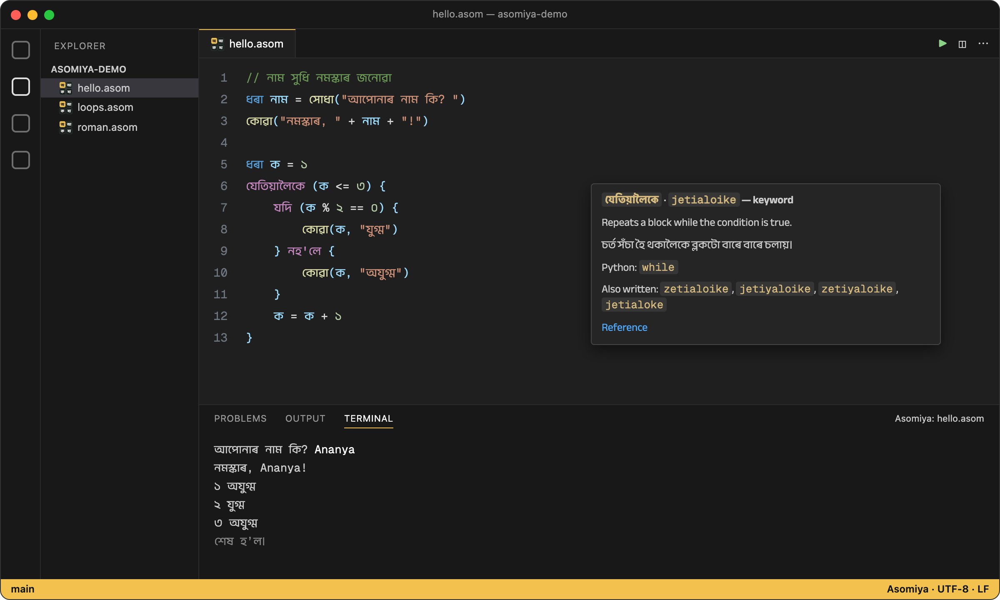
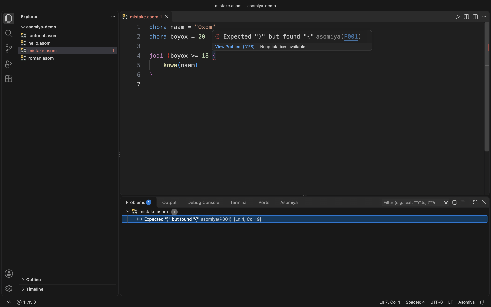

# Asomiya (অসমীয়া) for VS Code

Write code in Assamese. This extension adds full editor support for
[Asomiya](https://asomiya.codes), the programming language in Assamese, in **Assamese script** or
in **English letters** (`dhora`, `kowa`, `jodi`).



## Features

### Syntax colours in both scripts

Keywords, built-ins, text, numbers (`১২৩` and `123`) and comments are coloured, whichever way you
write. Every accepted spelling works: `nohole`, `noh'le` and `নহ'লে` are all the same keyword.

### Errors as you type

Mistakes are underlined while you type, with Asomiya's error code and a message in Assamese or
English. Click the code to read what it means and how to fix it.



### Hover help

Hover any keyword or built-in to see what it does, in English and Assamese, and what it is called
in Python.

### Run with one click

Press **▶** in the editor title (or **Cmd/Ctrl+F5**). The output appears in the **Asomiya** panel
next to Terminal, with Assamese letters joined properly. When the program asks a question
(`সোধা` / `xudha`), type the answer in the box at the bottom and press Enter. **Stop** (or
Ctrl+C) ends a program that runs too long. Nothing else to install: the interpreter is built
into the extension.

### Show in Python

Click **Show in Python** in the editor title to see the same program in Python, side by side,
updated as you type. It prints exactly the same output. Learn the ideas in Assamese, then see
them in the language the industry uses. **Asomiya: Save Python Version As…** saves it as a
`.py` file.


### Snippets

Type a keyword and press Tab:

| Type                        | You get                        |
| --------------------------- | ------------------------------ |
| `jodi` / `যদি`              | an if block                    |
| `jodinohole` / `যদিনহ'লে`   | if … else                      |
| `jetialoike` / `যেতিয়ালৈকে` | a while loop                   |
| `for` / `গণনা`              | a loop that counts from 1 to n |
| `fangchon` / `ফাংচন`        | a function                     |
| `xudha` / `সোধা`            | read input                     |

## Getting started

1. Create a file ending in `.asom`, for example `hello.asom`.
2. Write:

   ```
   ধৰা নাম = সোধা("আপোনাৰ নাম কি? ")
   কোৱা("নমস্কাৰ, " + নাম + "!")
   ```

   or, in English letters:

   ```
   dhora naam = xudha("Apunar naam ki? ")
   kowa("Nomoskar, " + naam + "!")
   ```

3. Press **▶**.

New to programming? Start with the [tutorial](https://asomiya.codes/learn/).

## Settings

| Setting                  | Default |                                                                                   |
| ------------------------ | ------- | --------------------------------------------------------------------------------- |
| `asomiya.errorLanguage`  | `as`    | Error messages in Assamese (`as`) or English (`en`).                              |
| `asomiya.digits`         | `auto`  | Print numbers as `১২৩`, `123`, or `auto` (`123` for programs in English letters). |
| `asomiya.checkAsYouType` | `true`  | Underline errors while typing.                                                    |

## Safe by design

- Checking for errors only reads your code; nothing runs until you press ▶.
- Asomiya programs cannot touch your files or the network, and endless loops can always be stopped.
- The extension has no dependencies and collects no data.

## Links

[Website](https://asomiya.codes) · [Playground](https://asomiya.codes/playground/) ·
[Language reference](https://asomiya.codes/reference/) · [Source code](https://github.com/d43ash1sh/asomiya) ·
[Report a problem](https://github.com/d43ash1sh/asomiya/issues)

Made in Assam. MIT licensed.
