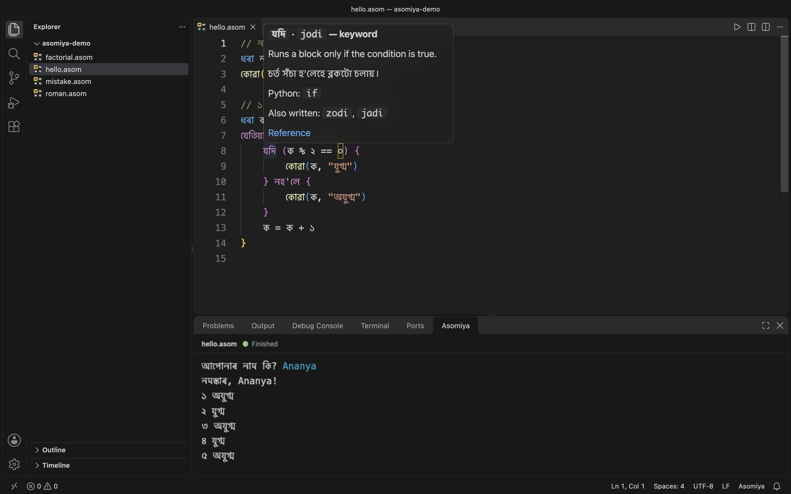
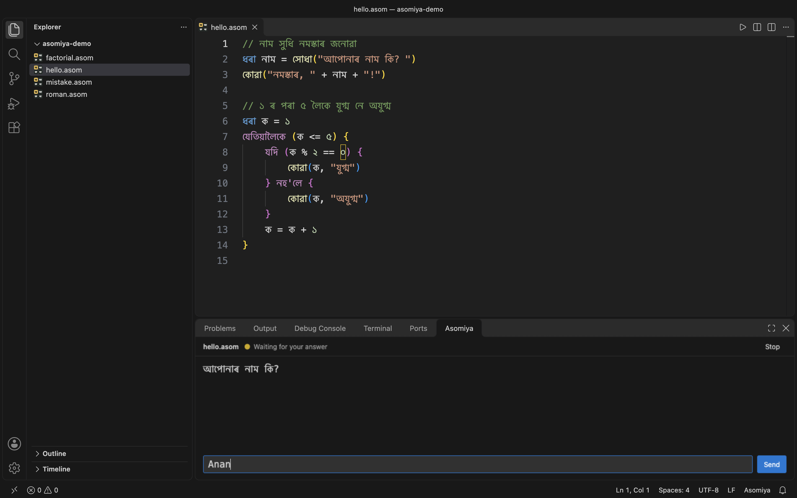
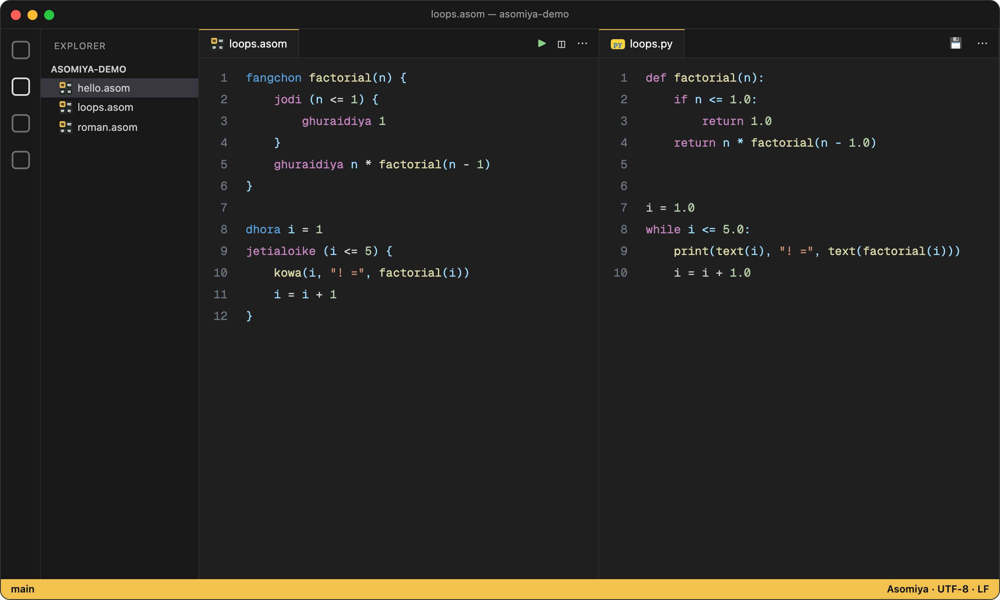
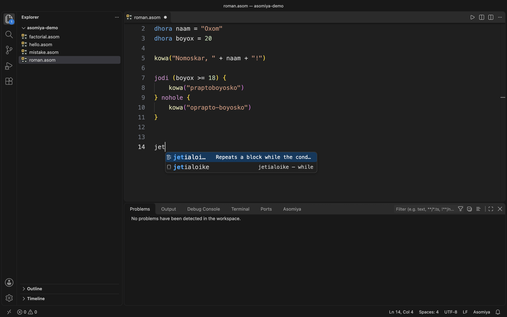

# Asomiya (অসমীয়া) for VS Code

Editor support for [Asomiya](https://asomiya.codes), a small programming language in Assamese.
Write in Assamese script, or in English letters (`dhora`, `kowa`, `jodi`) if you don't have an
Assamese keyboard.



## What it does

**Colours.** Keywords, built-ins, text, numbers (`১২৩` and `123`) and comments are coloured in
both scripts. Every spelling the language accepts works, so `nohole`, `noh'le` and `নহ'লে` are
all the same keyword.

**Run.** Press ▶ in the editor title, or Cmd/Ctrl+F5. The output appears in the **Asomiya**
panel next to Terminal. (The terminal itself can't join Assamese letters properly, which is why
the output has its own panel.) Nothing else to install: the interpreter is inside the extension.

**Questions.** When a program asks something with `সোধা` / `xudha`, a box appears at the bottom
of the panel. Type the answer and press Enter. **Stop** ends a program that runs too long.



**Mistakes, underlined as you type.** Each one has a code (like `P001`) that links to an
explanation, and the message can be in Assamese or English.


**Help on hover.** Point at a keyword or built-in to see what it means, in English and
Assamese, and what it's called in Python.

**Show in Python.** The split button in the editor title opens the same program in Python next
to yours, and it updates as you type. **Asomiya: Save Python Version As…** saves it as a `.py`
file.



**Suggestions and snippets.** Keywords and built-ins are suggested in the script you're writing
in. Type `jodi`, `jetialoike`, `fangchon`, `যদি` or `ফাংচন` and press Tab for a ready-made block.



## Try it

Make a file called `hello.asom`:

```
ধৰা নাম = সোধা("আপোনাৰ নাম কি? ")
কোৱা("নমস্কাৰ, " + নাম + "!")
```

or, in English letters:

```
dhora naam = xudha("Apunar naam ki? ")
kowa("Nomoskar, " + naam + "!")
```

Then press ▶. If you're new to programming, the [tutorial](https://asomiya.codes/learn/) starts
from the beginning.

## Settings

| Setting                  | Default | What it does                                                            |
| ------------------------ | ------- | ----------------------------------------------------------------------- |
| `asomiya.errorLanguage`  | `as`    | Error messages in Assamese (`as`) or English (`en`).                    |
| `asomiya.digits`         | `auto`  | Print numbers as `১২৩` or `123`. `auto` uses `123` for English letters. |
| `asomiya.checkAsYouType` | `true`  | Underline mistakes while typing.                                        |

## Good to know

- Checking for mistakes only reads your code. Nothing runs until you press ▶.
- Asomiya programs can't touch your files or the network, and Stop always works.
- No dependencies, no telemetry.

Found a problem or a word that sounds wrong in Assamese?
[Open an issue](https://github.com/d43ash1sh/asomiya/issues). The source is on
[GitHub](https://github.com/d43ash1sh/asomiya/tree/main/editors/vscode).

## Support

Asomiya is free and open source. If it helps you or your students, you can
[buy the maintainer a coffee ☕](https://buymeacoffee.com/debashishbordoloi007).
